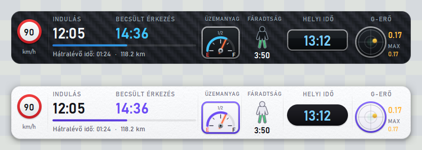

# HaulETA Simple(BETA)

**A lightweight telemetry overlay plugin for Euro Truck Simulator 2 and American Truck Simulator.**

**Version 0.1.9** · see [CHANGELOG.md](CHANGELOG.md) (from 0.1.8 on the plugin uses the same 0.x.y numbers; earlier builds were shown as 1.x, e.g. "HaulETA Simple 1.7" = 0.1.7)

HaulETA Simple shows the information you need on the road in one compact, modern panel: when you will arrive, how far you have come, the speed limit, your fuel, when you need to rest, the local time and the G-forces your cargo (or your passengers) feel. It reacts to your headlights and indicators with a back-lit edge glow, comes with a dark and a light theme, lets you pull parts of the panel out as separate elements, and speaks six languages.

> Built with **Claude (Anthropic)** — the plugin's code, design, textures pipeline and documentation were created in a collaboration with Claude.



---

## Features

| | |
|---|---|
| **Route & ETA** | Departure time, estimated real-world arrival time, time and distance left, and a route progress bar. |
| **Speed limit** | Current speed limit from the GPS as a road-sign style badge. |
| **Analog fuel gauge** | E – 1/2 – F dial with a needle; the scale fills up to the current level (accent colour, amber under a quarter, red in the reserve zone). |
| **Fatigue** | A figure that drains as your next rest approaches (green / amber / red) and a live countdown in in-game hours:minutes. |
| **Local time** | Large digits, blue by day and green in the in-game evening. |
| **G-meter** | Round dial with the force felt by the driver and passengers (sideways and forward/back), a short trail, the current value and a held peak, coloured by passenger comfort — made with the Coaches DLC in mind. |
| **Headlight glow** | The panel edge glows faint white with parking lights, brighter white with low beam and blue with high beam. |
| **Indicator glow** | The left or right side of the panel pulses amber in step with your blinker (both sides for hazard lights). |
| **Themes** | *Dark (carbon)*: carbon fibre and brushed metal. *Light*: white paper card with soft shadow, violet accents and a black clock pill. |
| **Detachable elements** | Show the G-meter and/or a route card (from → to, company names, time left) as separate panels anywhere on screen; the main panel gets shorter. |
| **Languages** | English (default), Magyar, Русский, Türkçe, Deutsch, Polski. |
| **TM Real Walk aware** | With the TM Real Walk plugin the panels hide while you walk outside the truck and come back when you sit in it again. |
| **Smooth & light** | Anti-aliased drawing with per-pixel transparency, animations only while something changes. |

## Requirements

- Windows 10 or 11, 64-bit
- Euro Truck Simulator 2 or American Truck Simulator (64-bit)

## Installation

1. Download [`bin/HaulETA.dll`](bin/HaulETA.dll) from this repository (or build it yourself – see below).
2. Copy it into the game's plugin folder, for example:
   ```
   ...\steamapps\common\Euro Truck Simulator 2\bin\win_x64\plugins\
   ```
   Create the `plugins` folder if it does not exist. For ATS use `American Truck Simulator\bin\win_x64\plugins\`.
3. Start the game. When SDK plugins are installed, the game shows a notice about them at startup – confirm it with OK.

 !!!  Only the single DLL is needed: all textures are built into it. Keep only one HaulETA DLL in the folder. !!!

## Usage

The panel appears when you start driving and hides while the game is paused or minimized.

| Hotkey | Action |
|---|---|
| **Ctrl+F11** | Moving mode: the panels get an accent-coloured rim and can be dragged with the mouse. Press again to lock them and save their positions. |
| **Ctrl+F12** | Settings window. |

### Settings window (Ctrl+F12)

- **Transparency** of all panels
- **Background** – Dark (carbon) or Light
- **Language** – English, Magyar, Русский, Türkçe, Deutsch, Polski (a new install starts in English)
- **Separate elements** – G-meter as a separate element; route card (from → to, time left) as a separate element

Every panel is always kept inside the game window. Settings are stored in
`%LOCALAPPDATA%\HaulETA-Simple\settings.ini`:

```ini
; main panel position (set with Ctrl+F11)
[simple]
x=1881
y=1333
saved=1
; transparency in percent, 0-80
[transparency]
eta=4
; theme: 0 = dark, 1 = light / language: hu, en, ru, tr, de, pl
[appearance]
theme=0
language=en
; 1 = shown as a separate element
[layout]
gmeter_separate=0
route_separate=0
; optional: in-game minutes treated as "fully rested" (default 600)
[fatigue]
full_minutes=660
```

Keep comments on their own lines – a comment after a value would become part of the value.

## How it works

HaulETA Simple is a native plugin for the official **SCS Telemetry SDK**. It only reads telemetry and never changes the truck or game state. It uses, among others:

| Telemetry | Used for |
|---|---|
| `truck.navigation.distance`, `truck.navigation.time`, `local.scale` | ETA, time and distance left, route progress |
| `truck.navigation.speed.limit` | speed limit badge |
| `truck.fuel.amount` + truck configuration `fuel.capacity` | fuel gauge |
| `rest.stop` | fatigue figure and rest countdown |
| `game.time` | day / evening clock colour |
| `truck.local.acceleration.linear` | G-meter |
| `truck.light.parking`, `truck.light.beam.low`, `truck.light.beam.high` | headlight glow |
| `truck.light.lblinker`, `truck.light.rblinker` | indicator glow |
| job configuration `source.city`, `source.company`, `destination.city`, `destination.company` | route card |

The overlay is a set of layered Windows windows drawn with GDI into 32-bit bitmaps (anti-aliased signed-distance shapes, per-pixel alpha via `UpdateLayeredWindow`).

## Building from source

Requirements: **Visual Studio** with the *Desktop development with C++* workload. The SCS Telemetry SDK headers are included in `scs_sdk_include\`.

```powershell
.\Build.ps1
```

The result is `build\HaulETA.dll`. `Build.ps1` compiles the textures in `assets\` into the DLL as resources.

Only if you change the textures or their sizes, regenerate the assets first:

```powershell
.\Prepare-Textures.ps1
```

| Path | Content |
|---|---|
| `HaulETA.cpp` | the whole plugin |
| `HaulETA.rc` | texture resources |
| `assets\` | textures at their exact on-screen sizes |
| `textures_src\` | original texture maps |
| `scs_sdk_include\` | SCS Telemetry SDK headers |

## Credits & licenses

- **Built with Claude (Anthropic).**
- **SCS Telemetry SDK** © SCS Software – see `SCS-SDK-LICENSE.txt`.
- **Textures** – free CC0 materials from [ambientCG](https://ambientcg.com): Fabric004 (carbon weave), Metal009 (brushed metal), Plastic004 (frosted plastic diffuser), Paper001 (white paper).
- **Fonts** – Bahnschrift / Segoe UI, as installed with Windows (not bundled).

Euro Truck Simulator 2 and American Truck Simulator are trademarks of SCS Software. This is an unofficial fan project and is not affiliated with or endorsed by SCS Software.

## Translations

Translations into English, Russian, Turkish, German and Polish were made with Claude. Corrections from native speakers are very welcome – open an issue or a pull request.
